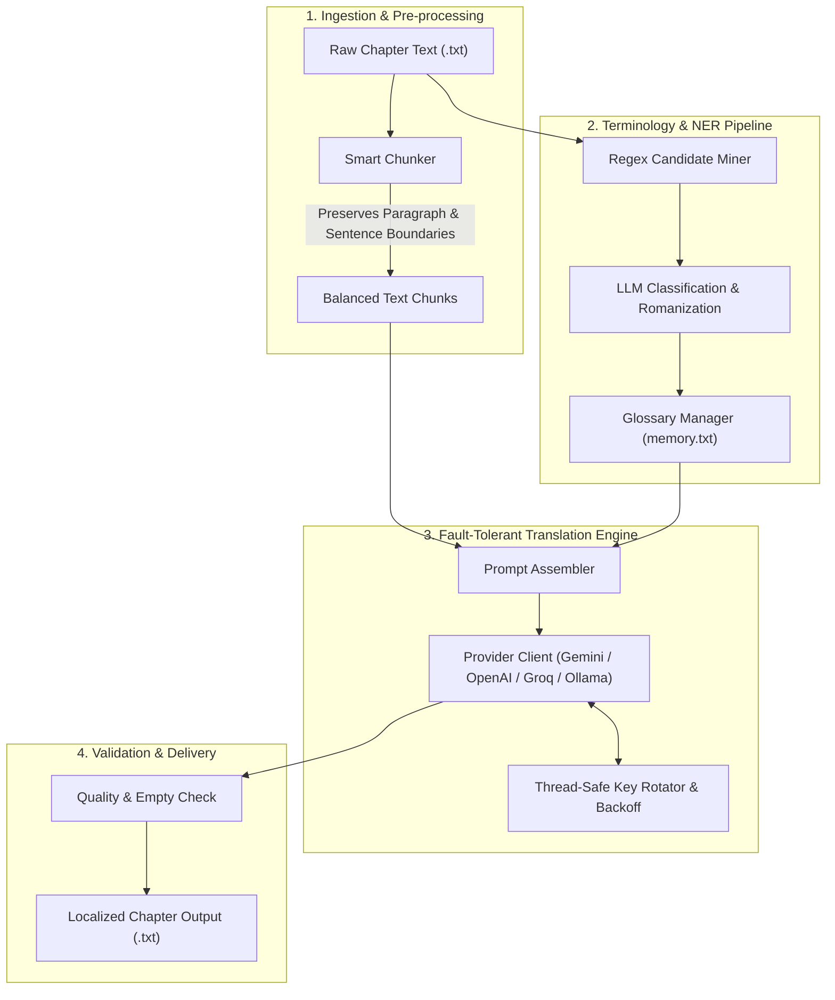

<div align="center">

# 📖 LLM Novel Localizer

**A production-grade, fault-tolerant localization pipeline for long-context web novels and light novels using Modern LLMs.**

[](https://www.python.org/)
[](https://opensource.org/licenses/MIT)
[]()
[](https://github.com/psf/black)

</div>

---

## 📌 Overview

Translating long-form literary works (such as serialized web novels and light novels) using LLMs poses significant engineering challenges:
1. **Context Window & Degradation:** Long chapters exceed reliable context limits or lead to hallucinations when processed in bulk.
2. **Terminology Inconsistency:** Without strict constraints, character names, techniques, and locations shift arbitrarily between chapters.
3. **API Fragility & Rate Limits:** Production translation workloads frequently trigger upstream rate limits (`HTTP 429`) and server overloads (`HTTP 502/503`).

**LLM Novel Localizer** is a modular, CLI-first engine designed to solve these exact problems. It provides automated entity extraction (NER), dynamic sentence-aware chunking, thread-safe API key rotation, and strict glossary conditioning.

---

## 🏗️ Architecture



---

## ✨ Key Features

- **Dynamic Sentence-Aware Chunking:** Intelligently balances text segments across natural paragraph breaks (`\n\n`) and punctuation boundaries (`.`, `!`, `?`, `。`, `！`), preventing awkward mid-sentence truncations.
- **Automated Named Entity Recognition (NER):** Extracts key characters, locations, and fantasy terminology with frequency analysis and automated LLM classification into structured JSON schemas.
- **Glossary-Conditioned Prompting:** Enforces strict terminology constraints across translation runs to maintain seamless consistency throughout entire volumes.
- **Resilient Key Rotation & Backoff:** Thread-safe key pool featuring round-robin rotation, automatic cooldown timers upon encountering `HTTP 429` (Rate Limit), and exponential backoff retry policies.
- **Provider-Agnostic Architecture:** Native support for Google Gemini (official `google-genai` SDK), OpenAI, OpenRouter, Groq, and local models via Ollama.
- **Modern CLI Interface:** Built with `Typer` and `Rich` for beautiful progress tracking, interactive tables, and error diagnostics.

---

## 🚀 Quickstart

### 1. Installation

Clone the repository and install dependencies:

```bash
git clone https://github.com/your-username/llm-novel-localizer.git
cd llm-novel-localizer
pip install -r requirements.txt
```

*(Optional) Install in editable mode:*
```bash
pip install -e .
```

### 2. Launch the Desktop GUI Application

You can launch the complete graphical desktop suite with a single click or command:

```bash
python Launcher.py
```

The GUI suite includes:
- **🌐 AI Translation Hub:** Batch translate chapters with provider selection, dynamic chunking, live stream preview, and terminology constraints.
- **✨ Style Polisher:** Refine translated drafts using preset styles (*RomCom, Dark Fantasy, Anime Style, Published Novel*) while preserving formatting and honorifics.
- **🔍 Terminology & NER Scanner:** Fast heuristic scanner + AI verification and romanization with direct export to `memory.txt`.
- **✂️ Novel Splitter:** Split massive aggregated .txt files into properly formatted chapters using multilingual regex patterns.
- **📚 EPUB Packager:** Convert translated chapters into formatted `.epub` books with table of contents, natural sorting, and AI cover generation.
- **⚡ 1-Click Auto Pipeline:** Automated workflow from raw chapters directly to final EPUB.
- **🔑 API Key & Rotation Manager:** Manage and auto-rotate keys across Gemini, OpenAI, Groq, OpenRouter, and local Ollama.

---

## 💻 CLI Usage (Headless & Automation)

### A. Extract Terminology (Glossary Builder)
Scan a folder of raw chapters to automatically extract names, organizations, and locations:

```bash
# Heuristic extraction
python -m src.cli extract-terms --input ./examples --output ./glossary.txt --min-freq 2

# With AI verification and romanization
python -m src.cli extract-terms --input ./examples --output ./glossary.txt --ai-cleanup
```

### B. Translate a Single Chapter or Folder
Translate raw chapters into fluent Vietnamese conditioned on your glossary:

```bash
# Translate a single chapter
python -m src.cli translate \
  --input ./examples/sample_chapter.txt \
  --output ./output/chapter_1.txt \
  --glossary ./examples/sample_glossary.txt \
  --provider Gemini

# Translate an entire directory with real-time progress bar
python -m src.cli translate \
  --input ./raw_chapters/ \
  --output ./translated_chapters/ \
  --glossary ./examples/sample_glossary.txt
```

---

## 🧪 Testing & Code Quality

The project includes unit tests for core modules, verifying chunking edge cases, terminology parsing, and thread-safe key rotation:

```bash
pytest
```

Output:
```text
tests/test_chunker.py ...                                                [ 37%]
tests/test_key_rotator.py ...                                            [ 75%]
tests/test_terminology.py ..                                             [100%]

============================== 8 passed in 0.31s ==============================
```

---

## 📂 Project Structure

```text
llm-novel-localizer/
├── src/
│   ├── core/
│   │   ├── exceptions.py     # Custom exception hierarchy
│   │   ├── key_rotator.py    # Thread-safe Key pool & Cool-down manager
│   │   └── llm_client.py     # Provider abstraction (Gemini, OpenAILike)
│   ├── processors/
│   │   ├── chunker.py        # Sentence-aware text chunking algorithm
│   │   ├── terminology.py    # NER extraction, parsing & Glossary management
│   │   └── translator.py     # End-to-end translation coordinator with retries
│   ├── config.py             # Pydantic schema validation & configuration
│   └── cli.py                # Command-line interface with Rich formatting
├── tests/
│   ├── test_chunker.py       # Boundary & threshold tests
│   ├── test_key_rotator.py   # Concurrency & cooldown tests
│   └── test_terminology.py   # Glossary parsing & candidate mining tests
├── examples/                 # Sample inputs & glossary templates
├── pyproject.toml            # Packaging & test configuration
├── requirements.txt          # Production dependencies
└── README.md
```

---

## 📄 License

This project is licensed under the [MIT License](LICENSE).

